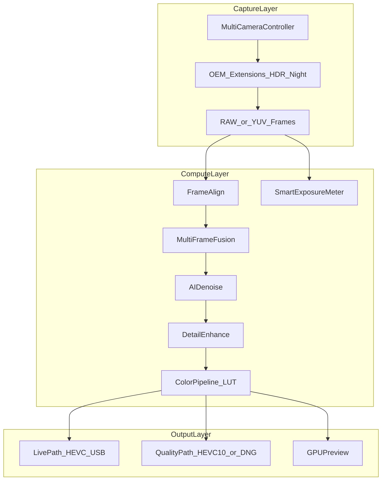

# Visión: la mejor app de cámara Android de terceros (para OBS + captura)

## Realidad técnica (sin autoengaño)

Una app de terceros **no puede reemplazar el ISP propietario** de Google/Samsung/Xiaomi al 100%.  
Lo que sí puede hacer —y casi nadie hace bien para streaming a OBS— es:

1. Usar **Camera2 al máximo** (RAW/YUV, controles manuales, multi-lente física)
2. Usar **Camera Extensions** (HDR/Night oficiales del OEM cuando existan)
3. Añadir un **pipeline computacional propio** (multi-frame, denoise IA, sharpen, color)
4. Coordinar **ultra / main / tele** con hysterésis inteligente
5. Ofrecer **dos caminos**: Ultra Calidad (más latencia) vs Ultra Bajo Latency (OBS en vivo)

Esa combinación es el producto: **calidad cercana a nativa + streaming pro a OBS**.

## Qué entra / qué no (Android)

| Feature | Viabilidad | Notas |
|---------|------------|--------|
| HEVC H.265 | Sí | Ya en marcha; priorizar Main10 si el device lo da |
| Multi-lente + auto switch | Sí | PHYSICAL_CAMERA_ID + zoom ratios |
| HDR via Extensions | Sí (devices) | CameraX/Camera2 Extensions |
| Multi-frame HDR propio | Sí | 2–5 frames; latencia alta → modo “Quality” |
| Denoise IA (TFLite/NPU) | Sí | En preview/Quality; en Live solo ligero |
| Detail enhance / unsharp | Sí | GPU (Vulkan/OpenGL) |
| Color science (LUT 3D) | Sí | Rec.709 / soft / vivid / cinematic |
| Exposición dinámica | Sí | Medición propia + AE override |
| HDR10 / HDR10+ stream | Parcial | Depende de encoder + sink; OBS limitado |
| Dolby Vision | Casi no | Licensing + APIs; no priorizar en v1–v2 |
| ProRes | No (Android) | Solo iPhone futuro |
| ISP full OEM | No | Usar Extensions + RAW donde se pueda |

## Arquitectura objetivo

### Dos modos de producto

- **Live OBS** (default): 1 frame, HEVC alto bitrate, denoise/detail **ligeros**, lens switch rápido  
- **Studio Quality**: multi-frame HDR + IA denoise + color LUT (latencia 100–400 ms; ideal grabación o USB 3 estable)

## Roadmap por fases

### Fase A — Cimientos pro (ahora)
- MultiCameraController (listar físicas, ultra/main/tele)
- Auto lens switch por zoom ratio + histéresis
- Tap-to-focus + AE/AF/AWB lock
- Métricas pro (ISO real, shutter, temp, fps, drops)
- Modo Live vs Quality en UI

### Fase B — Computational lite (Live-safe)
- Smart exposure metering (ROI cara/centro)
- GPU detail enhance + mild denoise temporal 2-frame
- Color presets + 3D LUT loader
- HEVC Main10 cuando exista

### Fase C — Computational heavy (Studio)
- Multi-frame align + HDR merge (2–5)
- AI denoise TFLite (NPU si hay)
- Optional RAW capture bracket
- Camera Extensions Night/HDR como fallback OEM

### Fase D — Formatos / pro delivery
- HDR10 metadata experiment (si encoder + OBS lo toleran)
- Export DNG/HDR stills
- Perfil de color “match native” calibrado por modelo

### Fase E — iPhone (aparte)
- ProRes / Dolby Vision solo cuando exista app iOS
- Continuity-like UX, no compartir código ISP

## KPIs de “mejor app de terceros”

- En Live: ≥1080p60 o 4K30 estable USB, latencia percibida &lt;120 ms  
- En Studio: detalle/ruido subjetivamente ≥ mejores apps webcam + cerca de nativa en luz media  
- Auto-lens sin “saltos” molestos  
- No tumbar OBS ni calentar el teléfono en 20 min (throttle inteligente)

## Principio de producto

> No fingir ser el ISP de Samsung/Google.  
> Ser la **mejor capa pro encima de Camera2** pensada para creadores que usan OBS.
